<div align="center">

# 🚌 City Bus Tracker

**Real-time public bus tracking for Indian cities.**<br>
Live bus positions straight from the drivers' phones, arrival times for every stop, journey planning with transfers,
and a safety layer that gets every SOS to the depot in seconds.


[Try it in 2 minutes](#-try-it-in-2-minutes) ·
[Screenshots](#-screenshots) ·
[How it works](#-how-it-works) ·
[Features](#-features) ·
[Run for real](#-run-for-real) ·
[Tests](#-tests)

<br>

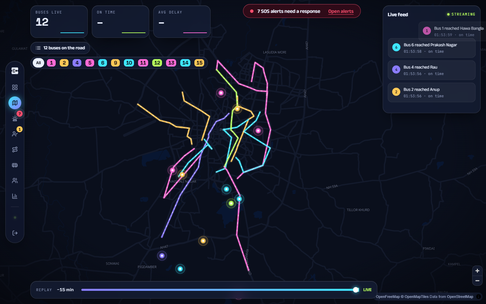

<sub>The depot's live map: 12 simulated buses on Indore's network, with a streaming feed of stop arrivals and a 15-minute replay slider.</sub>

</div>

---

## ✨ At a glance

<table>
<tr>
<td width="33%" valign="top">

### 🧍 Passengers
Open the app, no sign-up needed. See the **nearest stop**, which bus is coming and **in how many minutes**,
plan a trip from A to B, and press **SOS** if something goes wrong.

</td>
<td width="33%" valign="top">

### 🧑‍✈️ Drivers
Sign in, start the trip, and the phone becomes the bus's GPS. A big **distance-to-next-stop** dial,
**slide to end trip**, one-tap incident **reports** and **SOS**.

</td>
<td width="33%" valign="top">

### 🏢 Depot admins
A live **fleet board**, a city-wide **live map**, an **alerts center** with sound, **driver applications**,
a **route & stop editor**, and **reports**.

</td>
</tr>
</table>

| Folder | What it is | Stack |
|---|---|---|
| [`backend/`](backend) | API + realtime server | Node, Express 5, MongoDB, Socket.IO |
| [`admin-panel/`](admin-panel) | Depot dashboard (web) | React 18, Vite, Tailwind, MapLibre |
| [`driver-app/`](driver-app) | Driver app (Android/iOS) | Expo SDK 58, Expo Router |
| [`passenger-app/`](passenger-app) | Passenger app (Android/iOS/web) | Expo SDK 58, Expo Router |
| [`shared/`](shared) | Code used by all of the above | design tokens, i18n packs, geo helpers, native UI kit |

Design system: [DESIGN.md](DESIGN.md) ("Ticket Stock"). Product context: [PRODUCT.md](PRODUCT.md).

---

## 🚀 Try it in 2 minutes

No database to install. The demo starts an in-memory MongoDB, loads Indore and runs simulated buses.

```bash
cd backend && npm install && npm run demo      # in-memory DB + Indore + simulated buses  → :5000
cd admin-panel && npm install && npm run dev   # depot dashboard                          → http://localhost:3000
cd passenger-app && npm install && npx expo start --web
cd driver-app && npm install && npx expo start --web
```

| Who | Email | Password |
|---|---|---|
| Admin | `admin@demo.local` | `Demo@1234` |
| Drivers | `demo.driver1@transit.local` … `demo.driver12@transit.local` | `Demo@1234` |
| Passenger | *no account needed* | |

<details>
<summary><b>What's in the demo city?</b></summary>

<br>

- **Indore**: 108 stops and 12 routes from [`backend/data/indore.json`](backend/data/indore.json), morning timetables,
  12 buses, and 2 pending driver applications.
- Stops marked `approx` in that file were estimated. Drag them into place in the admin **Route Editor**.
- `npm run demo -- --city=chandigarh` runs the old Chandigarh demo (4 routes, used by the tests).
- `npm run demo -- --no-sim` starts the demo without the simulated buses.
- Everything lives in memory and is gone when you stop the server.

</details>

---

## 📸 Screenshots

<sub>All screenshots are from the local demo (`npm run demo`) with simulated buses. No real riders or data.</sub>

### Passenger app

<table>
<tr>
<td align="center" width="25%">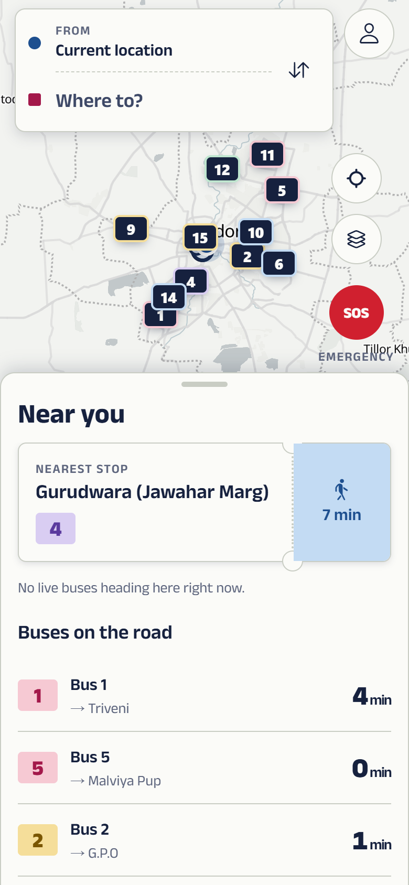<br><b>Near you</b><br><sub>Nearest stop, walking time, buses on the road with minutes to arrival</sub></td>
<td align="center" width="25%">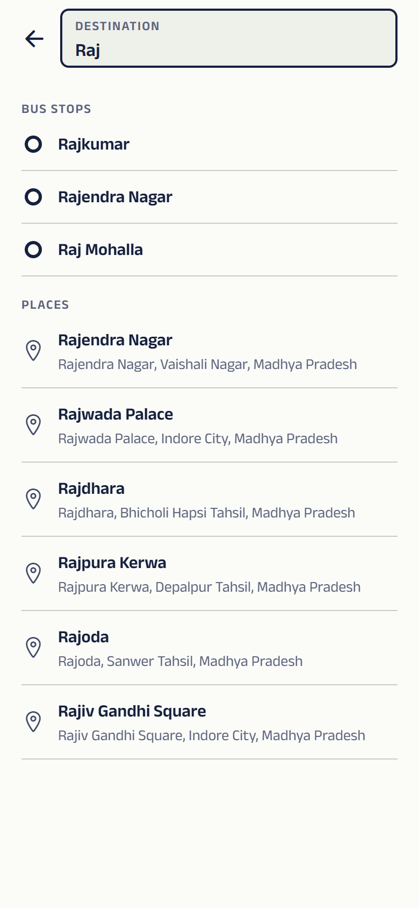<br><b>Search</b><br><sub>Bus stops first, then places (Photon / OpenStreetMap)</sub></td>
<td align="center" width="25%">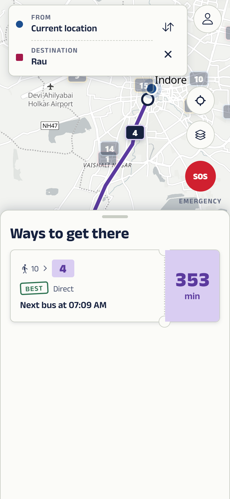<br><b>Ways to get there</b><br><sub>Time-aware: at 2 AM it waits for the first timetabled bus</sub></td>
<td align="center" width="25%">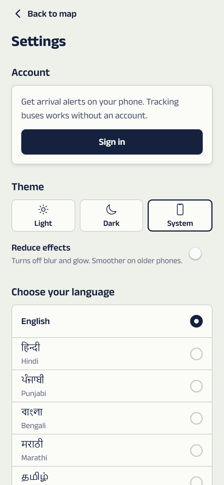<br><b>Settings</b><br><sub>Theme, reduced effects, 11 languages in their own scripts</sub></td>
</tr>
</table>

### Driver app

<table>
<tr>
<td align="center" width="50%">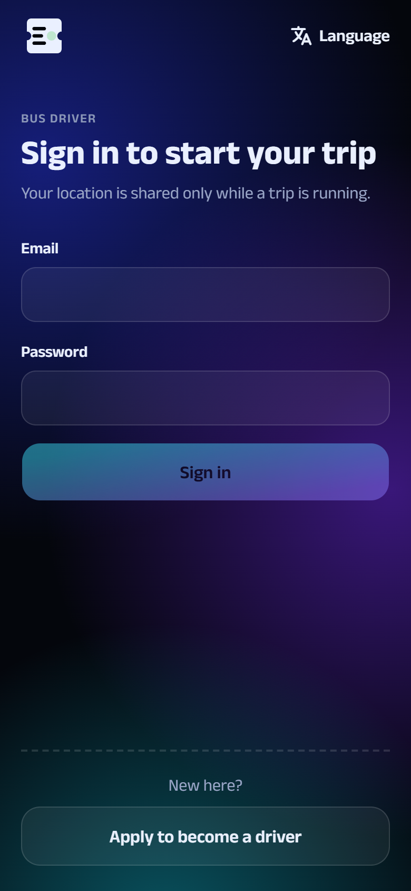<br><b>Sign in or apply</b><br><sub>New drivers apply with licence and ID photos</sub></td>
<td align="center" width="50%">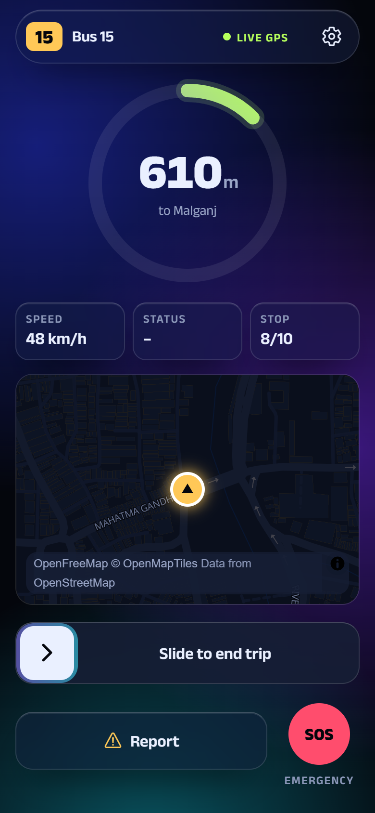<br><b>On a trip</b><br><sub>Distance to next stop, speed, progress, slide to end, Report and SOS</sub></td>
</tr>
</table>

### Admin panel

<details open>
<summary><b>Dashboard: fleet board + needs-a-response</b></summary>
<br>
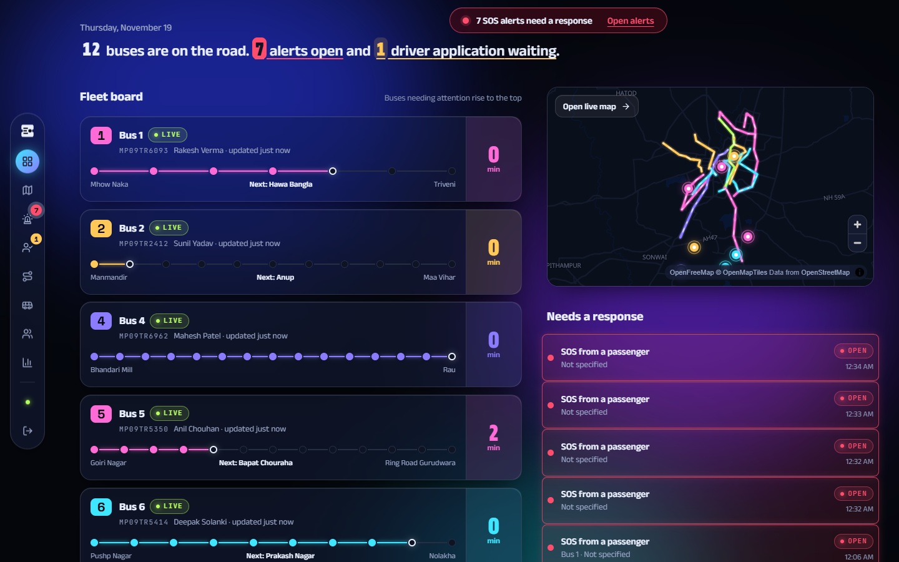
</details>

<details>
<summary><b>Alerts center: SOS with live location</b></summary>
<br>
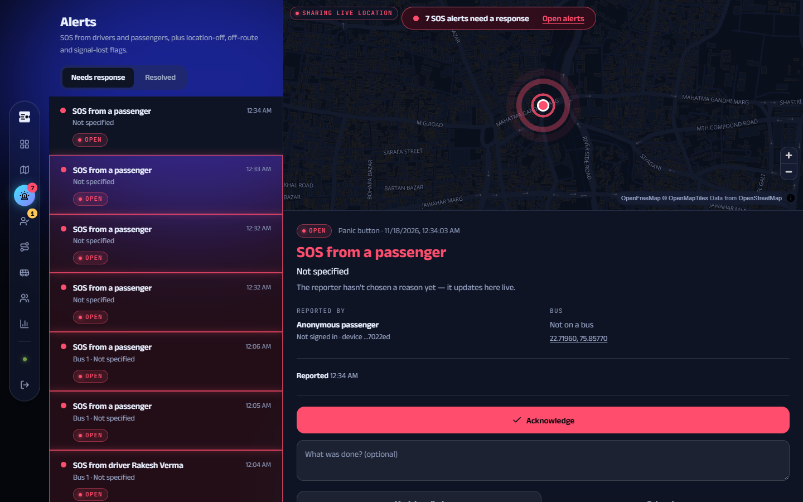
</details>

<details>
<summary><b>Driver applications: review documents, approve or reject</b></summary>
<br>
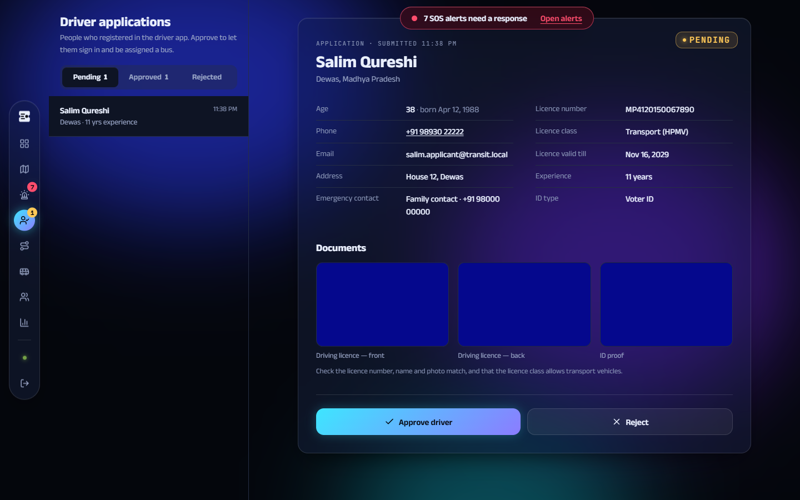
</details>

<details>
<summary><b>Routes & stops editor</b></summary>
<br>
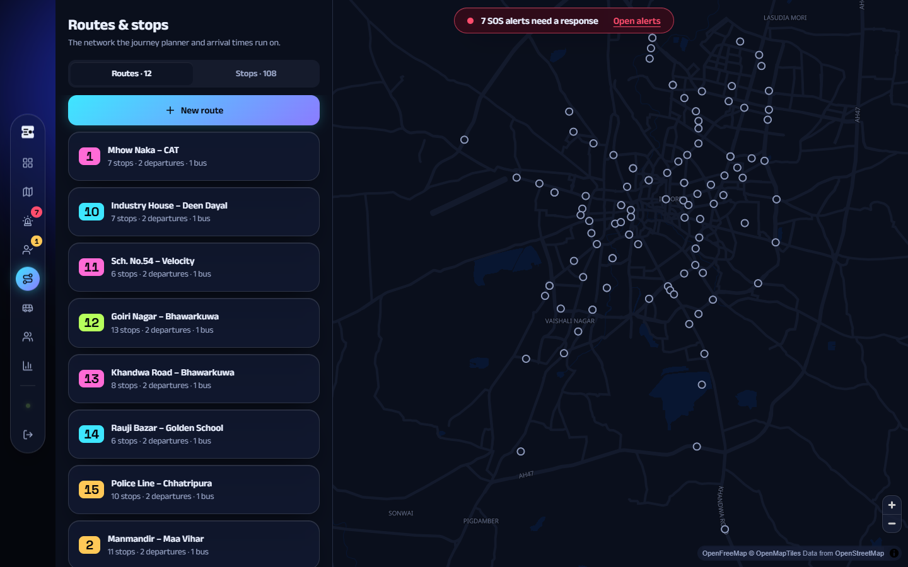
</details>

<details>
<summary><b>Reports: trips, distance, punctuality, incidents</b></summary>
<br>
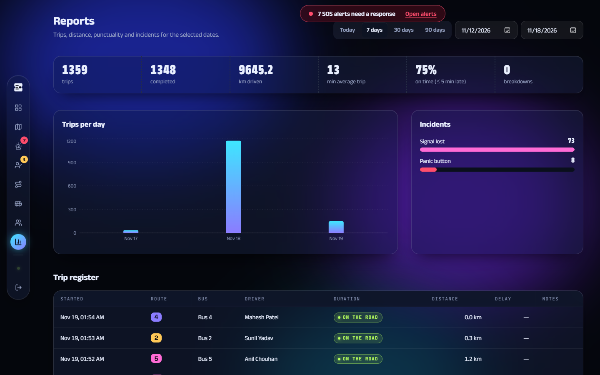
</details>

---

## 🧭 How it works

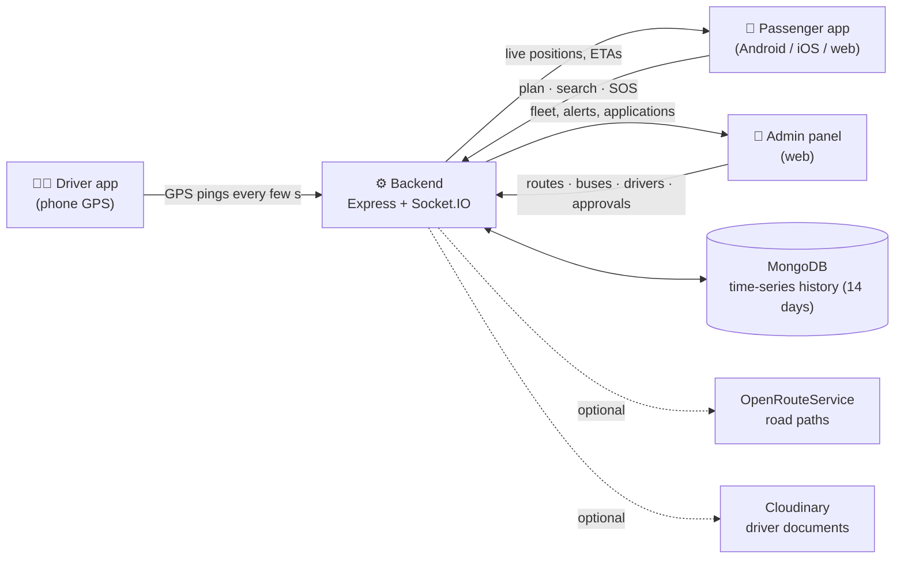

1. **Drivers' phones are the GPS.** Each ping is handled in memory with no database reads, and history is sampled into a
   time-series collection that expires after 14 days.
2. **The server works out ETAs** per stop, delay against the timetable, and raises **off-route** (> 150 m for 2 min) and
   **signal-lost** (no ping for 60 s) flags.
3. **Everyone gets it live over Socket.IO.** Bus markers glide between positions. Safety events go only to an
   authenticated admin room.

---

## 🧩 Features

<details>
<summary><b>📍 Live tracking & arrival times</b></summary>

- GPS pings are handled in memory (no DB reads); history is sampled into a time-series collection and expires after 14 days.
- Arrival times per stop, delay against the timetable.
- **Off-route** (> 150 m for 2 min) and **signal-lost** (no ping for 60 s) flags.
- Bus markers glide between positions; the admin map has a 15-minute **replay** slider.

</details>

<details>
<summary><b>🗺️ Journey planner</b></summary>

- Time-dependent Dijkstra over the stop network: walking, waiting (live bus → timetable → estimate), transfers.
- Up to 3 options; nearest stop + best bus on the passenger home screen.
- Search shows bus stops first, then places from Photon (OpenStreetMap data), proxied through the backend.

</details>

<details>
<summary><b>🚨 Safety</b></summary>

- **Hold-to-send SOS** for drivers *and* passengers, with no login needed. The reason is picked afterwards.
- 15-minute live location trail and a **Call 112** shortcut.
- **Location-off warnings** for drivers: 15 s → warning, and after 2 warnings the depot is notified.
- Admin **Alerts center** with sound and desktop notifications.

</details>

<details>
<summary><b>🪪 Driver applications</b></summary>

- Drivers apply in the app with licence and ID photos.
- The depot approves, or rejects with a reason. Documents are never publicly reachable.

</details>

<details>
<summary><b>🛠️ Route & stop editor</b></summary>

- Create and edit routes and stops on the map, with a timetable generator.
- Road-path generation via OpenRouteService (straight lines without a key).
- Import a real city from GTFS: `node scripts/importGtfs.js <unzipped-gtfs-folder> --prefix=DL-`.

</details>

<details>
<summary><b>🌐 11 languages</b></summary>

English, Hindi, Punjabi, Bengali, Marathi, Tamil, Telugu, Gujarati, Kannada, Malayalam, Odia
(`shared/i18n/locales/*.json`).

**Add a language** = one JSON file + one line each in `shared/i18n/languages.js` and `resources.js`.

> Non-English packs are machine drafts. Have a native speaker review them.

</details>

<details>
<summary><b>🗺️ Maps</b></summary>

OpenFreeMap vector tiles (OpenStreetMap data, no key). For a public launch in India, consider Ola Maps or Mappls for
official boundaries; change `shared/mapConfig.js`.

</details>

---

## 🏗️ Run for real

<details open>
<summary><b>1. Backend</b></summary>

Copy `backend/.env.example` to `.env`, set `MONGODB_URI` and `JWT_SECRET`, then:

```bash
cd backend && npm install
node create-admin.js you@example.com "a-strong-password"   # see CREATE_ADMIN.md
npm run seed        # optional demo data
npm start
```

Load a real city from GTFS: `node scripts/importGtfs.js <unzipped-gtfs-folder> --prefix=DL-`.

</details>

<details>
<summary><b>2. Admin panel</b></summary>

Set `VITE_API_URL=https://your-backend/api` in `admin-panel/.env`, then `npm run build` and deploy `dist/`.

</details>

<details>
<summary><b>3. Driver & passenger apps</b></summary>

Set `EXPO_PUBLIC_API_URL` in `driver-app/.env` and `passenger-app/.env`.

- Phones need a development or preview build: `npx eas-cli@latest build --profile development`
  (or `--profile preview` for an installable APK).
- The passenger web app deploys with `npx expo export --platform web`.

</details>

<details>
<summary><b>☁️ Free hosting (Render blueprint)</b></summary>

[`render.yaml`](render.yaml) creates all four services (backend, admin panel, passenger web, driver web) on Render's free plan
(dashboard → **New → Blueprint** → pick this repo). You need a MongoDB Atlas M0 connection string for `MONGODB_URI`.

Keep the free backend awake with a [cron-job.org](https://cron-job.org) request to `/api/health` every 10 minutes.

</details>

### Optional integrations

All are free tiers, and everything works without them.

| Variable (backend `.env`) | Adds | Without it |
|---|---|---|
| `ORS_API_KEY` (openrouteservice.org) | Real road paths + driver re-routing | Straight lines between stops |
| `CLOUDINARY_URL` | Private cloud storage for driver documents | Stored on the server disk |
| `GOOGLE_WEB_CLIENT_ID` (+ Android/iOS) | "Continue with Google" for passengers | Button hidden; email sign-in |
| `CORS_ORIGINS` | Allowed web origins in production | Any `localhost` port (dev only) |

---

## 🧪 Tests

```bash
cd backend && npm test
```

| Suite | Covers |
|---|---|
| `unit.test.js` | geo helpers, Dijkstra, location-off warnings, schedules |
| `e2e.test.js` | full API + sockets against an in-memory MongoDB |
| `migrations.test.js` | data migrations |
| `gtfs.test.js` | GTFS import |

---

## 🔒 Security notes

- No default admin; admins are created with `backend/create-admin.js`.
- Logins are rate-limited; deactivated or unapproved drivers are rejected immediately.
- Panic/incident and application events go only to an authenticated admin socket room.
- Driver documents are never publicly reachable; admins view them through an authenticated endpoint.
